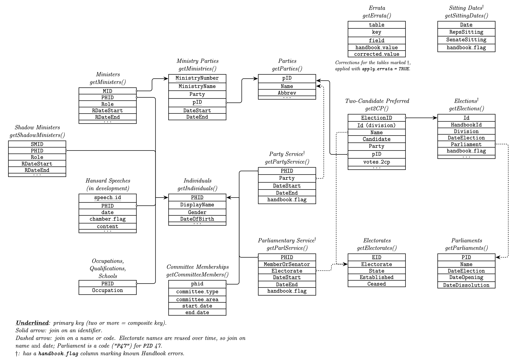

<!-- README.md is generated from README.Rmd. Please edit that file -->

```{r, include = FALSE}
knitr::opts_chunk$set(
  collapse = TRUE,
  comment = "#>",
  fig.path = "man/figures/README-",
  out.width = "100%" 
)
```

# ausPH 

<!-- badges: start -->

<!-- badges: end -->

The goal of ausPH is to retrieve data from the [Parliamentary Handbook
of the Commonwealth of Australia](https://handbook.aph.gov.au/) and
return ready-to-analyse data, formatted as a `tibble`. The package
relies on the data from the Handbook site, which is subject to change
and improvement. Functions that query the Handbook's API return `NULL`,
with a message, if the API cannot be reached.

At present, the package contains the following functions:

- `get2CP` (Data on two candidate preferred results since 1919)[^1]
- `getCommitteeMembers` (Data on committee memberships since 1901)
- `getElections` (Data on elections since 1901)[^2]
- `getElectorates` (Data on electorates since 1901)
- `getIndividuals` (Data on individuals and biographical information
  since 1901)
- `getParlService` (data on parliamentary tenures of MPs and senators
  since 1901)
- `getParliaments` (Data on Parliamentary terms since 1901)
- `getMinisters` (Data on Ministers since 1901)
- `getShadowMinisters` (Data on Shadow Ministers since 1901)
- `getParties` (Data on Parties since 1901)
- `getPartyService` (Data on Party Service of MPs and Senators since
  1901) 
- `getMinistries` (Data on Ministries and Governing Parties since
  1901) 
- `getOccupations` (Data on all pre-parliamentary occupations listed
  since 1901)
- `getQualifications` (Data on all listed qualifications)
- `getSchools` (Data on all listed secondary schools)
- `getSittingDates` (Data on all parliamentary sitting dates since
  1901) 
- `getErrata` (Known errors in the Handbook, with corrections)

[^1]: `get2CP()` returns a stored copy of the Handbook's results, with
    any elections held since added from the Handbook (see below). Where
    the Handbook has no result for a division, a result from another
    source is used instead, documented in the `Note` and `source`
    variables.

[^2]: Two elections the Handbook does not list (the Wide Bay by-election
    of 1928 and the Dickson supplementary election of 1993) are added,
    with the package's own identifiers and flagged `not_in_handbook`.
    `HandbookId` gives the Handbook's own identifier for every other
    election.

## Data map

How the tables returned by ausPH link together. Hansard speeches are in
development.



The diagram is drawn from `data-raw/data_map.tex`.

## Errors in the Handbook

The Handbook is an excellent source, but it contains some errors. ausPH
returns the Handbook's data as it is by default, and marks rows with a
known problem in a `handbook_flag` column, for example terms that
overlap the member's previous term, or sittings recorded for a chamber
that did not sit.

The flag column is returned by `getParlService()`, `getPartyService()`,
`getSittingDates()` and `getElections()`. Where the correct value is
known, it is listed with its evidence in `getErrata()`, and passing
`apply_errata = TRUE` to these functions uses the corrected value
instead (no corrections are listed yet for `getPartyService()`):

``` r
getParlService(chamber = "house", apply_errata = TRUE)
```

If you find another error, please [open an
issue](https://github.com/palesl/ausPH/issues).

## Stored data and updates

Some tables would take many requests to retrieve from the Handbook in
full, so the package stores a copy and, by default, brings it up to date
when you call the function:

| Function | By default | Requests |
|----|----|----|
| `getParlService()` | retrieves the whole table from the Handbook | 1 |
| `getElections()` | adds elections listed since the stored copy | 2 |
| `get2CP()` | adds results for elections since the stored copy | about 3, plus 1 per new election |
| `getSittingDates()` | adds sitting dates after the stored copy | 1 per year |
| `getPartyService()` | stored copy only; `update = TRUE` re-fetches everyone who has served since (about 250 requests, two to three minutes) | 0 |

Use `update = FALSE` to work from the stored copy alone, e.g. offline or
for reproducibility. If the Handbook cannot be reached, these functions
return the stored copy with a message. The date of the stored copy is in
the `scraped` attribute and the date of any update in the `updated`
attribute, e.g. `attr(getElections("all"), "updated")`.

## Installation

You can install the development version of ausPH from
[GitHub](https://github.com/palesl/ausPH) with
[pak](https://pak.r-lib.org/):

``` r
# install.packages("pak")
pak::pak("palesl/ausPH")
```

or, if you already use it, with `remotes`:

``` r
# install.packages("remotes")
remotes::install_github("palesl/ausPH")
```

## Citation

Please cite this package as the following:

> Leslie, Pat. 2026. “ausPH: An R Package to Retrieve Data from the
> Parliamentary Handbook of the Commonwealth of Australia.” R package
> version 1.0.1. <https://github.com/palesl/ausPH>.

Bibtex format entry:

```         
@misc{leslie_ausph_2026,
    title = {{ausPH}: {An} {R} package to retrieve data from the {Parliamentary} {Handbook} of the {Commonwealth} of {Australia}.},
    url = {https://github.com/palesl/ausPH},
    author = {Leslie, Pat},
    year = {2026},
    note = {R package version 1.0.1},
}
```

## Examples

These examples show some simple functionality of the package:

```{r example}
library(ausPH) 
## get elections

getElections(chamber = "all", byelections = T)

## get a list of parliaments

getParliaments()

## get two candidate preferred since 1919

get2CP()

## known errors in the Handbook

getErrata()
```

Last updated: 26 October 2026. See `NEWS.md` for changes.

## Image Attribution

Hex image icon: Canberra Parliament House by Anna Hatzisavas from [Noun
Project](https://thenounproject.com/browse/icons/term/canberra-parliament-house/ "Canberra Parliament House Icons")
